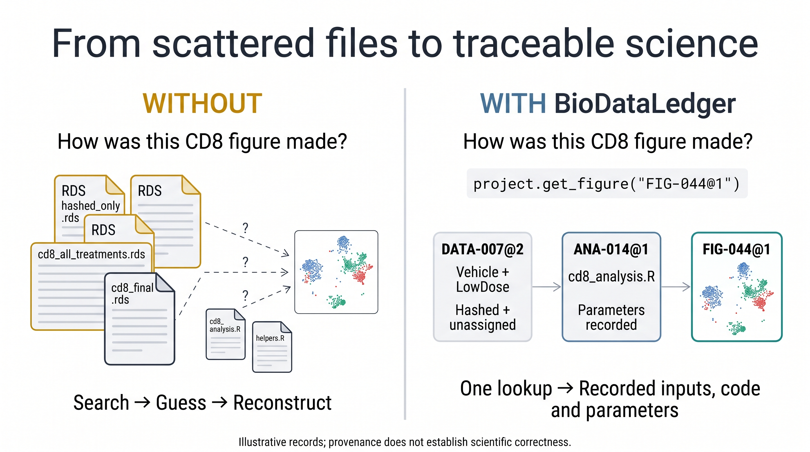
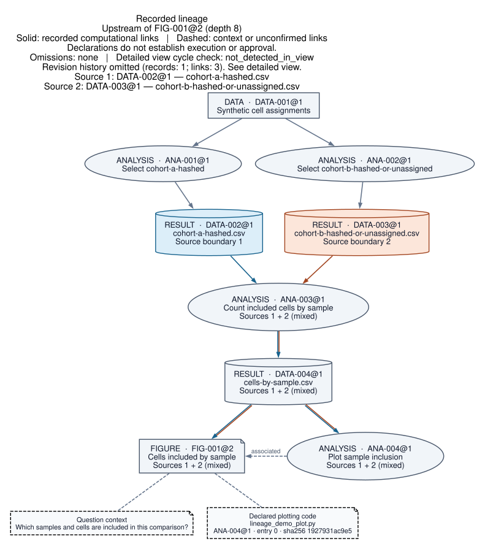

# BioDataLedger

**Resume your analysis without reconstructing its history.**

BioDataLedger helps you find retained figures and data and trace them to the
exact inputs, code and parameters you recorded. It works in R and Python with
your existing files, so you can recover those links when you reopen a project
or hand it to a colleague.



The example illustrates records you supply; the package does not choose or verify the cohort for you.

[Install](#install) · [Update a running project](docs/UPDATING.md) · [Examples](#record-data-analyses-and-figures) · [Find retained outputs](#find-retained-figures-and-data) · [Trace a figure](#export-a-project-graph) · [Conditions and levels](#conditions-and-levels) · [Agent instructions](#using-an-agent) · [API reference](docs/API.md)

For a new analysis or redraw that must keep its loaded native object paired with
the exact resolved input reference, see [Retained inputs](docs/RETAINED_INPUTS.md).
It is a project-helper pattern, not a migration instruction for existing helpers.

## Install

Version **0.17.0** · MIT license · Tested on **macOS**. Install Python, R, or both. No AI service is required.

Version 0.17.0 adds a project overview, a quick help menu, and a lookup for recent
figure paths in R and Python. The [API reference](docs/API.md) covers both clients.
See the [changelog](CHANGELOG.md).

Already using BioDataLedger? Follow the [safe upgrade guide and copy-paste agent
prompt](docs/UPDATING.md) before changing a live R or Python session.

**R — install the tested version from GitHub**

Run this in R to install version 0.17.0 from its release tag:

```r
if (!requireNamespace("remotes", quietly = TRUE))
  install.packages("remotes", repos = "https://cloud.r-project.org")

remotes::install_github(
  "nbatada/biodataledger",
  subdir = "r",
  ref = "v0.17.0",
  upgrade = "never"
)
```

Then load it with `library(BioDataLedger)`.

**Python — install version 0.17.0 directly from GitHub**

```sh
python3 -m pip install "git+https://github.com/nbatada/biodataledger.git@v0.17.0#subdirectory=python"
```

Use an isolated Python environment as needed. For an immutable installation, replace
`v0.17.0` with the release's full commit SHA in either installation command.

**Source checkout — repository examples or a source install**

```sh
git clone https://github.com/nbatada/biodataledger.git
cd biodataledger
git checkout v0.17.0
```

**Python 3.9 or newer**

```sh
python3 -m venv .venv
.venv/bin/python -m pip install ./python
.venv/bin/python -c 'import biodataledger; print(biodataledger.__version__)'
```

Use `.venv/bin/python` or select this environment in your editor. Installation needs setuptools/wheel; the package has no Python runtime dependencies.

**R from the source checkout**

```sh
mkdir -p .r-library
export R_LIBS_USER="$PWD/.r-library"
Rscript -e 'install.packages(c("jsonlite", "digest", "zip", "uuid", "stringi"), repos="https://cloud.r-project.org")'
R CMD INSTALL -l "$R_LIBS_USER" r
Rscript -e 'library(BioDataLedger); print(packageVersion("BioDataLedger"))'
```

Skip the dependency installation if those packages are already available (`zip` ≥3.0.2). In a new shell, set `R_LIBS_USER` to the absolute path of `.r-library` before starting R. In an open R session, add that path with `.libPaths(c("/absolute/path/to/.r-library", .libPaths()))`.

Offline installation requires the build tools and dependencies to be available locally.

## Try it

From the repository root, run the R example (or the Python equivalent):

```sh
Rscript examples/trial_R.R "$PWD/trial-r" "$PWD/examples/input-files"
.venv/bin/python examples/trial_python.py "$PWD/trial-python"
```

The R command uses your selected library. For a custom library, keep the earlier
`R_LIBS_USER` export; in an interactive R session, add its path with `.libPaths()`.

Each creates and reopens a new project with one dataset, one analysis and two
retained figures. It prints exact project/record/revision references and missing
execution evidence, then writes `trial-context.zip` and `trial-working.zip` inside
that project. Existing destinations are never overwritten.

The context ZIP contains metadata and history. The working ZIP also contains the
selected synthetic input, both figures and their code snapshot. On the receiving
Mac, set these two paths and open the copied working ZIP in R:

```r
library(BioDataLedger)
archive_path <- "/absolute/path/to/trial-working.zip"
import_root <- "/absolute/path/to/new-project"
q <- ProjectBundle$import_zip(archive_path, project_dir = import_root)
q$status()
input <- q$resolve_data(purpose = "qc", verify = "sha256")
figures <- q$find_figures(type = "qc")
q$get_figure(figures[[1]]$ref, compact = TRUE)
```

Either native client can inspect either client's ZIP; import preserves exact
references and runs no analysis. Data objects such as Seurat/RDS and AnnData/H5AD
remain in their native formats. A context ZIP supports metadata inspection;
its omitted input must be supplied separately before it can be resolved.

## Record data, analyses and figures

For your own project, set `project_root` to its existing folder. Use `create` once and `open` on later visits. Run your analysis normally, then register the saved outputs and call `save()`.

The examples below assume a fresh folder containing copies of `examples/input-files/`. Use a different folder from an initialized trial project. Python uses `qc.py`; R uses `qc.R`.

<details>
<summary>Python</summary>

```python
from biodataledger import ProjectBundle
p = ProjectBundle.create("Synthetic study", project_dir=project_root)
d = p.register_data("input.csv", role="analysis_ready", hash=True)
p.set_current(d, purpose="qc", reason="Scientist-selected synthetic trial input")
p.save()

p = ProjectBundle.open(project_dir=project_root)
d = p.resolve_data(purpose="qc", verify="sha256")
a = p.register_analysis("QC", inputs=[d.ref], code="qc.py",
                        method="synthetic display", params={"min_genes": 200})
# After the analysis declaration is staged, native analysis can use d.path
# and write its outputs. The figures here are already saved synthetic fixtures.
f1 = p.register_figure("library.svg", type="qc", analysis=a)
f2 = p.register_figure("genes.svg", type="qc", analysis=a)
p.save()
print(p.status())
figures = p.find_figures(type="qc")
figure = p.get_figure(path="library.svg")
print(figure.inputs, figure.code, figure.params, figure.provenance)
print(p.get_figure(f1, compact=True))
preserved_source = p.read_figure_source(f1)
print(preserved_source["content"].decode("utf-8"))
```

</details>

<details>
<summary>R</summary>

```r
library(BioDataLedger)
p <- ProjectBundle$create("Synthetic study", project_dir = project_root)
d <- p$register_data("input.csv", role = "analysis_ready", hash = TRUE)
p$set_current(d, purpose = "qc", reason = "Scientist-selected synthetic trial input")
p$save()

p <- ProjectBundle$open(project_dir = project_root)
d <- p$resolve_data(purpose = "qc", verify = "sha256")
a <- p$register_analysis("QC", inputs = list(d$ref), code = "qc.R",
                        method = "synthetic display", params = list(min_genes = 200))
# After the analysis declaration is staged, native analysis can use d$path
# and write its outputs. The figures here are already saved synthetic fixtures.
f1 <- p$register_figure("library.svg", type = "qc", analysis = a)
f2 <- p$register_figure("genes.svg", type = "qc", analysis = a)
p$save()
print(p$status())
figures <- p$find_figures(type = "qc")
figure <- p$get_figure(path = "library.svg")
print(list(inputs = figure$inputs, code = figure$code, params = figure$params, provenance = figure$provenance))
print(p$get_figure(f1, compact = TRUE))
preserved_source <- p$read_figure_source(f1)
cat(rawToChar(preserved_source$content))
```

</details>

Project helpers can keep domain-specific loading outside BioDataLedger. Pass the
opened project and an exact registered reference into a helper; call
`resolve_data(..., verify="sha256")` once before loading through native R/Python.
See the [portable helper example](docs/RETAINED_INPUTS.md#keep-the-resolved-source-with-the-loaded-object).

For a planned retained result, see the [R/Python registration workflow](docs/RETAINED_INPUTS.md):
find candidates, verify the chosen revision, stage the analysis before writing
outputs, then register and save the related records together.

## Check a loaded scientific input (R prototype)

`ledger$check_object(object, purpose="comparison", assay="RNA", layer="counts")`
compares a supplied object's sample-qualified cells, treatment/replicate mapping,
selected representation and required cluster assignments against registered
references. It prints PASS/FAIL/UNKNOWN for each field and returns BLOCKED when a
required field is not PASS. Seurat support is optional; a generic R interface works
without it. The checker does not prove downstream use or scientific validity.

This R-only prototype is included. See the [manual example and report contract](docs/api/OBJECT_CHECK_V1.md).

## Inspect and resume

Inspect the loaded project with `print(ledger)` in R or `print(p)` in Python.
The overview lists up to four recently registered analyses by ticket or analysis
name, with exact revision references and linked output names. It also shows the
project folder, recorded current input choices, and the file and folder paths for
the latest active figure by registration.

Use `ledger$help()` or `p.help()` for common inspection commands and the
[full API reference](docs/API.md). Use `ledger$recent_figures()` or
`p.recent_figures()` for more figure paths. These views use loaded metadata and
leave file availability unchecked. Registration dates describe registry entries.
Use the recorded run history to inspect execution evidence.

Use `summary_text()` for the technical card. Pass `purpose="comparison"` to
inspect that input choice. Use `status()` for structured metadata including the
loaded package version, registry revision and unsaved changes. Unsaved changes
remain in memory until an explicit save or an execution-receipt save.

Open the project once and use exact getters for frequent metadata lookups. Availability is unknown until explicitly checked: use `check_files=True` in Python (`TRUE` in R) for existence, or `resolve_data(..., verify="sha256")` for a selected input's byte integrity. Clean `save()` performs no disk write. A loaded object does not automatically refresh after another writer saves.

Use `get_data(role=...)` for a unique role or `get_data(purpose=...)` for an
explicit current choice. To find candidate DATA or DEC revisions by name, use
the [bounded structured graph search](docs/api/GRAPH_V1.md). Keep the chosen
exact ref; a partial or ambiguous search cannot choose it for you.

**Updating an older input helper:** `availability_checked=False` means unchecked,
not unavailable. Use `resolve_data(..., verify="sha256")` for verified input
resolution and preserve the same exact reference or purpose. See the
[older input helper example](docs/api/API_0.11.0.md#updating-older-input-helpers).

Figure search matches registered paths, explicit asset IDs, names, types and descriptions, plus the name and description
of each figure's recorded analysis revision. Results contain the latest active
figure revisions and their inherited context. Search reads loaded metadata only.

Dataset scope can record the saved population, assay/layer and an exact design revision. These declarations do not prove biological membership. See the [API reference](docs/API.md#set_data_scope), [existing-project intake](docs/ADOPTION.md) and [declared-file recovery](docs/RECOVERY.md) guides. Recovery preserves code/file layout; it does not install a runtime or run an analysis.

## Inspect a figure and its preserved source

Analytical inputs stay attached to the exact analysis. A saved result table used
for rendering can be declared separately through `figure_sources` when registering
a figure, or through `update_record`. Supply its exact DATA reference; the relationship to the analytical input stays
`unknown` by default. Set `relationship="declared"` only for an explicit scientist
declaration. Hashes, snapshots and matching names never promote that relationship. An
optional generating-code selector names an existing exact analysis/figure revision
and zero-based code index. It reuses the recorded digest and snapshot.

Use `get_figure(ref, compact=True)` (R: `compact = TRUE`) for a bounded source
report. Exact references stay unambiguous; a bare figure ID, asset alias or
registered path rejects when several revisions match. Source/dependency file
availability is unchecked until `check_files=True`, and existence does not verify
integrity or establish complete dependencies.

`read_figure_source(ref)` returns at most 1 MiB of digest-verified bytes. It uses a
recorded snapshot even after the original script changes. A missing snapshot never
falls back to the original. Multiple recorded scripts require an exact code
selection. Reading preserved code does not establish that it executed or generated
the figure. See the [figure-source API](docs/API.md#read_figure_source)
for R/Python source selectors and evidence fields.

## Conditions and levels

`condition` names the metadata column. `levels` lists the available categories; `selected_levels` records the intended comparison. `reference_level` sets its baseline, and `replicate` names the biological replicate column. These declarations do not filter data.

For an open project `p`, this synthetic example records Vehicle versus LowDose:

<details>
<summary>Python</summary>

```python
p.set_design(
    condition="treatment",
    levels=["Vehicle", "LowDose", "HighDose"],
    selected_levels=["Vehicle", "LowDose"],
    reference_level="Vehicle",
    replicate="mouse_id",
    selection_reason="HighDose excluded due to low RNA complexity"
)
p.save()
print(p)
print(p.get_design_summary())
```

</details>

<details>
<summary>R</summary>

```r
p$set_design(
  condition = "treatment",
  levels = c("Vehicle", "LowDose", "HighDose"),
  selected_levels = c("Vehicle", "LowDose"),
  reference_level = "Vehicle",
  replicate = "mouse_id",
  selection_reason = "HighDose excluded due to low RNA complexity"
)
p$save()
p
p$get_design_summary()
```

</details>

Use `get_design()` for the full record or `get_design_summary()` for a compact view. Each change creates a revision. Earlier analyses and their figures retain their recorded design. Optional [`check_design_metadata()`](docs/API.md#check_design_metadata) checks supplied columns. See the [design API](docs/API.md#experimental-design) for the design getters.

Analysis registration uses the project design as a default and pins that exact
revision once. Pass `design_ref` to choose another exact design, or explicit
`None` (R: `NULL`) to record unknown design. DATA scope describes available file
contents; selected design levels describe the intended comparison. Extra
available levels do not mean the file was filtered.

`input_mode="separate"` checks each known input's declared scope. Use explicit
`input_mode="combined"` when separate condition files jointly support a comparison;
this declaration does not pool or merge files. `check_context(ref)` reports known
contradictions and missing context without reading scientific data. Declared
consistency does not establish biological correctness or scientific approval.

To check a retained figure's bytes, use `resolve_figure(ref, verify="sha256")`.
Ordinary `get_figure` remains a metadata lookup. To preserve an existing saved
figure, call `save_figure(source, type, analysis=...)`, then `save()`. This copies
one file into an exclusive managed location. Pass `ref` instead of analytical
context to append an existing figure's revision. Older copies and external files
are never overwritten. An external file's hash alone provides no preserved copy.
See the [figure-copy API](docs/API.md#save_figure).

## Share a result

Preview the export, then save selected files to a ZIP. **ZIPs include the whole registry's metadata and history**, even when only a few files are selected. Review sensitive information and missing dependencies before sharing; a ZIP is not a guarantee that an analysis will run elsewhere.

These examples continue from above. Set `archive_path` to a new ZIP filename and `import_root` to a new directory.

<details>
<summary>Python</summary>

```python
plan = p.preview_export("working", include=[d.ref, f1, f2])
print(plan)
p.export_zip(plan, path=archive_path)
q = ProjectBundle.import_zip(archive_path, project_dir=import_root)
print(q.get_figure(f1).provenance)
print(q.check(hashes=True))
```

</details>

<details>
<summary>R</summary>

```r
plan <- p$preview_export("working", include = list(d$ref, f1, f2))
print(plan)
p$export_zip(plan, path = archive_path)
q <- ProjectBundle$import_zip(archive_path, project_dir = import_root)
print(q$get_figure(f1)$provenance)
print(q$check(hashes = TRUE))
```

</details>

Use `preview_export("context")` for metadata only. Import checks packaged hashes and does not execute scripts or fetch missing files.

## Using an agent

Install the package, fill in the brackets and paste this into your coding agent:

```text
Use BioDataLedger for this project.
Project folder: [absolute path]
Language: [R or Python]
Task: [what I want to do]

Use the current API reference in docs/API.md.
Open the registry once. Print the handle to check the loaded package version,
registry revision and unsaved changes, then read compact status().
If no registry exists, ask before creating one.
Use exact dataset references or my chosen current-for-purpose input.
Report missing files, ambiguous choices and unknown provenance.
Ask before changing the cohort, design or current dataset.
For authorized work, register saved results with their known inputs,
code and parameters, then save. Preserve staged work on a stale-write error.
Preview all files and metadata before an authorized export.
```

Use the [current API reference](docs/API.md) for signatures and the [agent guide](docs/agent/USAGE.md) for operating guidance.

Keep the project loaded in the active process and query it only when needed.
There is no required call on every chat turn. Group related lookups when a tool
starts a fresh process, and save once after meaningful record changes. A loaded
object retains its revision; reopen deliberately for another writer's updates.

## Limits

Records describe the sources you supply; they are not proof that code ran or that a result is scientifically valid. Data remain native files, and selecting levels does not subset an object.

`get_analysis(ref).evidence` and `get_figure(ref).evidence` distinguish declared
input/code relationships from execution evidence (R uses `$evidence`).
Ordinary registration does not capture analysis execution, so execution remains
unknown and `execution_evidence` appears in the missing-information list even when
every declared field is present. Explicit `run_analysis` receipts are inspected
separately with `get_execution`; they record invocation and boundary checks while
input consumption and scientific validity remain unknown. Hashes, code snapshots
and successful imports do not establish execution.

Older projects remain readable. Saving experimental design requires clients ≥0.3.0; DATA scope/design records require clients ≥0.4.0; explicit analysis input modes and managed figure copies require clients ≥0.5.0. Windows/Linux writes, network/cloud-synced folders, power-loss recovery and exports over 4 GiB remain unverified. The R maintainer-contact placeholder is unresolved; no PyPI or CRAN release has been published.

## Tests

After installing both clients:

```sh
BDL_R_LIB="$PWD/.r-library" .venv/bin/python -m unittest discover -s tests -p 'test_*.py' -v
R CMD build r
R CMD check --no-manual BioDataLedger_0.17.0.tar.gz
```

## Confirm a saved change

Use `ledger.save_and_confirm()` in Python and
`ledger$save_and_confirm()` in R. Call it after a related result batch and immediately after a completed
current-input, design or scientific-decision change. It saves **all pending edits**,
including figures registered earlier, and returns the previous/new registry
revision, transaction ID and `scope="all_pending_changes"`.

`status="persisted"` and `registry_written=True/TRUE` confirm successful registry
publication, not scientific approval. A failed save raises an error and retains
pending edits. A clean call returns `no_changes`, performs no disk I/O and does not
refresh a stale session. Registration/setters still need an explicit save boundary;
there is no background autosave or rollback transaction. See the
[persistence receipt](docs/API.md#save_and_confirm).

## Exact derived results

`register_result()` registers an existing result file by reference. Explicit options
can hash or copy it. The result remains an ordinary DATA revision linked to its
producing ANA; a figure names that exact DATA revision as its rendering input.
`dependencies()` retrieves bounded upstream/downstream metadata without reading
scientific payloads. Commit the related batch with `save_and_confirm()`.

`check_result()` explicitly checks CSV coordinates, qualified cell identities,
alignment and available independent membership evidence. Seurat reduction and
AnnData obsm references are supported without loading objects; their unmeasured
alignment remains UNKNOWN.
See the [result contract](docs/api/RESULTS_V1.md) for examples, limits and compatibility.

## Export a project graph

Use `project.export_graph()` in Python or `project$export_graph()` in R to get a
project overview page as DOT text. Pass an exact reference such as `"FIG-001@1"`
to trace recorded upstream or downstream lineage. Clients such as CCF can consume
`format="structured"` for the same view as a `biodataledger-graph/1` report.
Export reads loaded registry metadata and needs neither Graphviz nor a GUI.

Each response is capped at 100 nodes, 100 edges and 128 KiB. Focused traversal
supports depths from 1 to 10. An overview page examines up to 1,000 registry
slots and 1,000 indexed outgoing edges. It shows only edges with both endpoints
on that page, so combining pages can still miss relationships. Use focused
queries to inspect links across pages and check the reported cutoffs.

See the [graph contract](docs/api/GRAPH_V1.md) and the synthetic PRMT5 examples
in [Python](examples/dependency_graph.py) and [R](examples/dependency_graph.R).

### Trace a retained figure

Use `style="presentation"` for top-to-bottom DOT with exact revision labels
and notes for recorded questions and plotting code. The
[synthetic lineage demo](docs/LINEAGE_DEMO.md) generates sample counts and a
plot in either R or Python. In a fresh process it finds the figure by recorded
topic and question, then recovers the exact count table and plotting script.
The lineage points to the earlier cohort revision recorded for that figure.

<details>
<summary>View the synthetic lineage diagram</summary>



</details>

With the demo project open as `project`, export its figure and color the two
recorded cohort branches.

```py
from pathlib import Path

dot = project.export_graph(
    "FIG-001@2", depth=8, style="presentation",
    lineage_roots=["DATA-002@1", "DATA-003@1"],
)
Path("lineage.dot").write_text(dot, encoding="utf-8")
```

```R
dot <- project$export_graph(
  "FIG-001@2", depth = 8L, style = "presentation",
  lineage_roots = c("DATA-002@1", "DATA-003@1")
)
writeLines(enc2utf8(dot), "lineage.dot", useBytes = TRUE)
```

Focused presentation graphs omit revision links and records reachable only
through them. The header counts omissions and reports query cutoffs. Use the
default detailed view to inspect revision links. Colors trace declared
relationships, including the figure's exact rendering inputs. Execution and
scientific approval require separate evidence.

If you have Graphviz installed, run `dot -Tsvg lineage.dot -o lineage.svg` to
render the DOT file.

## Optional execution receipts

Use `run_analysis` when you explicitly want to execute a named function from a
registered code snapshot and retain an execution receipt. It saves a started record,
checks selected input/code identity, invokes the function, then records its outcome
and output hashes. `get_execution` and `execution_summary` inspect an exact receipt.
Ordinary registration remains available without a runner.

Receipts distinguish observed invocation from declared inputs and unknown input
consumption or scientific validity. Failed or interrupted runs remain visible.
See the [native execution contract and examples](docs/api/EXECUTION_V1.md).


## Scientific decisions and annotations

Use `record_scientific_decision` to retain exact subjects, separate cluster IDs and
annotation labels, supporting/contradictory evidence, and a declared scientific
status. Revisions preserve earlier interpretations. `get_decision` retrieves an
exact typed or legacy decision; persist changes with `save_and_confirm`.

An approved status is a submitted claim, not authenticated scientific approval.
See the [native decision contract](docs/api/DECISIONS_V1.md).


## Find related work

Use `related_work(input_ref=data_ref)` for an exact registered input, or
`related_work(query="TCR clonality")` when you know the topic but not the dataset.
The compact report returns registered analysis candidates, exact input/result/figure
references and qualified provenance. Text matches do not imply scientific equivalence
or approved reuse; missing and ambiguous matches stay explicit.

Queries read metadata without loading scientific objects or changing the registry.
See [matching rules, native examples and limits](docs/api/RELATED_WORK_V1.md).

### Find retained figures and data

- **Start with a topic.** Call `p.find_outputs(topic="QC")` in Python or
  `p$find_outputs(topic = "QC")` in R to find figures and data tagged `QC`
  or with a tag such as `QC-samples`.
- **Start with an analysis.** Call `get_info("ANA-001@1")` with its exact
  reference to see named inputs and immediate outputs.
- **Start with a figure.** Call `get_info("FIG-001@2")` with its exact reference
  to see the declared plotting script and rendering inputs, recorded questions,
  and links to slides or manuscripts. Plotting code stays unknown without an
  explicit selection. The recorded links do not prove which script ran.
- **Name a retained output.** Register the saved file, then use `set_presentation`
  to record its generation date, primary topic and description. Pass the
  returned exact revision to `output_name(ref)` for a suggested filename such
  as `20261105_QC-samples_F001r2_donor-view.svg`. The file stays in place.
  Use `export_named_output` if you want a digest-verified copy with that name.

These queries read registry metadata. See the [paired Python and R examples](docs/api/OUTPUT_DISCOVERY_V1.md).

### Ordered protocols

Retain ordered protocols and compare selected
execution receipts with their exact inputs, methods, fixed parameters and required
outputs. It separates data-dependent results and unknown evidence. Approval is a
scientist-submitted decision pinned to one protocol revision.
See the [protocol contract](docs/api/PROTOCOLS_V1.md) and
[current protocol API](docs/API.md#register_protocol).

### Execution chronology

With an open project `p`, call `timeline_summary()` to see when each record
revision was registered. Use the runs view to see recorded runs, their inputs
and registered outputs. `print(p)` still shows the compact project card.

**Python**

```python
print(p.timeline_summary(view="registration", order="oldest"))
print(p.timeline_summary(view="runs", order="newest"))
page = p.timeline(view="registration", order="oldest", limit=2)
if page["next_cursor"] is not None:
    next_page = p.timeline(view="registration", order="oldest", limit=2,
                           cursor=page["next_cursor"])
```

**R**

```r
cat(p$timeline_summary(view = "registration", order = "oldest"), "\n")
cat(p$timeline_summary(view = "runs", order = "newest"), "\n")
page <- p$timeline(view = "registration", order = "oldest", limit = 2L)
if (!is.null(page$next_cursor)) {
  next_page <- p$timeline(view = "registration", order = "oldest", limit = 2L,
                          cursor = page$next_cursor)
}
```

Known times appear in UTC. Run times describe the recorded execution wrapper.
Both sort orders put unknown times last, including runs with imported or open
receipts. `timeline()` returns structured pages of up to 10 rows by default.
Set `limit` from 1 to 20. Each report is capped at 64 KiB. Continue with
`next_cursor` on the same loaded project using the same view and order. Start
from the first page after editing or reopening the project.

`execution_history()` retrieves bounded recorded runs by project, exact analysis
or protocol. Pairwise timing evidence preserves overlaps, ties, failures and
unknowns; display order is not an inferred execution sequence.
`execution_history_summary()` returns compact text in Python and R. See
[the chronology contract](docs/api/CHRONOLOGY_V1.md).

### Comparison evidence

Record explicit reproduce/reapply/rerender plans and exact candidate assessments
with `register_comparison_plan`, `record_comparison_assessment` and `get_comparison`.
Required evidence yields scoped PASS/FAIL/UNKNOWN; comparison records cannot act
as scientific approval. No analysis or hashing is triggered. See the
[comparison contract](docs/api/COMPARISONS_V1.md).
